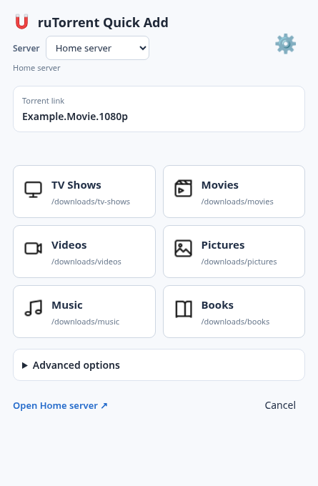
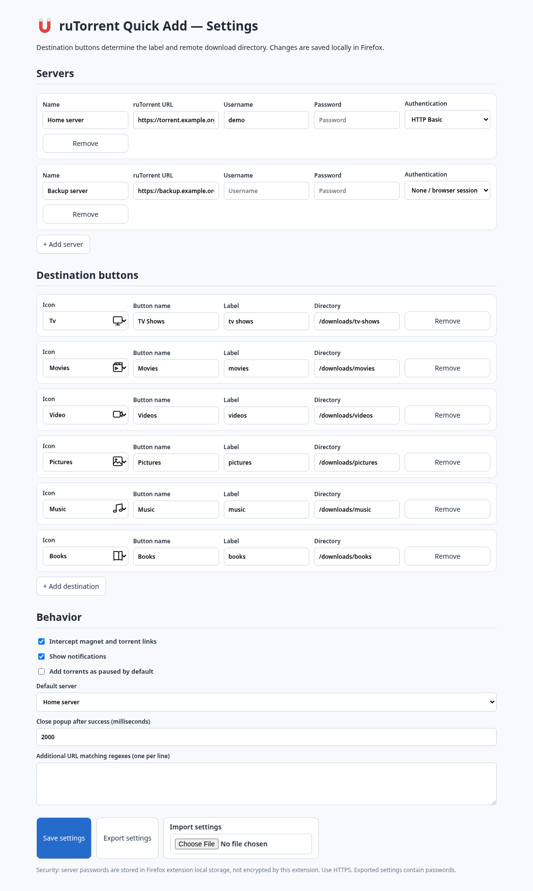

# ruTorrent Quick Add

Send magnet and `.torrent` links from Firefox or Chrome to a remote ruTorrent server using one-click destination buttons.

> **v1.0.4 — dual-browser source release candidate.** The Firefox implementation is based on v1.0.3; the Chrome Manifest V3 port has not yet been tested against a live ruTorrent instance. The ZIPs built here are **unsigned**.

## Screenshots

**Torrent destination picker**



**Settings and destination icons**



*Screenshots use fictional example configuration, not a live server.*

## Features

- Magnet and `.torrent` link interception, plus context-menu submission
- Multiple ruTorrent servers
- Configurable labels and server-side download directories
- Monochrome destination icons: TV, Movies, Video, Pictures, Applications, Games, Music, Books, Magazines, Anime, General
- HTTP Basic or browser-managed session authentication
- HTTPRPC verification and automatic popup close after confirmed success
- Import/export of settings

## Install for development

Build both packages:

```bash
python3 scripts/build.py
```

**Firefox:** open `about:debugging#/runtime/this-firefox`, choose **Load Temporary Add-on**, then select `browsers/firefox/manifest.json` **only if files are assembled together**. For a reliable temporary install, extract `dist/rutorrent-quick-add-firefox-1.0.4-unsigned.zip` to a folder and select its `manifest.json`.

**Chrome:** open `chrome://extensions`, enable **Developer mode**, select **Load unpacked**, and choose the extracted `dist/rutorrent-quick-add-chrome-1.0.4-unsigned.zip` folder.

Configure the extension in its Options page. Paths refer to the **remote rTorrent host**, not your computer.

## Publish

- **Firefox Add-ons:** upload the Firefox ZIP to Mozilla for review/signing. Keep the already-submitted v1.0.3 unchanged; use v1.0.4 for the next submission. For a public listing, Mozilla handles updates.
- **Chrome Web Store:** upload the Chrome ZIP. Chrome review is independent of Mozilla review.
- **GitHub:** tag a release (for example `v1.0.4`) and optionally attach the unsigned ZIPs for developers. Normal Firefox installations require Mozilla signing.

## Source layout

```text
src/                  Shared UI, settings, styles, images and SVG icons
browsers/firefox/     Firefox Manifest V2, background, capture, shared-settings adapter
browsers/chrome/      Chrome Manifest V3, service worker, capture, shared-settings adapter
scripts/build.py      Reproducible dual-browser packaging
dist/                 Generated unsigned extension ZIPs (gitignored)
.github/workflows/    Automatic syntax checks and build artifacts
screenshots/          Illustrative UI screenshots
```

Build locally with `python3 scripts/build.py firefox` or `python3 scripts/build.py chrome`. GitHub Actions runs both builds on pushes and pull requests and publishes artifacts in the Actions run; **it does not publish to extension stores automatically**.

## Privacy and security

The extension does not include analytics or advertising. It sends torrent links and metadata to servers you configure. Credentials are stored in extension local storage without extension-level encryption; **never commit exported settings**. Use HTTPS for remote servers. Broad website permissions support torrent-link interception and user-configured servers. See [PRIVACY.md](PRIVACY.md).

## Contributing

Issues and PRs are welcome. Please remove credentials, tracker passkeys and private torrent URLs from logs before sharing. See [CONTRIBUTING.md](CONTRIBUTING.md).

## License

[MIT](LICENSE).
